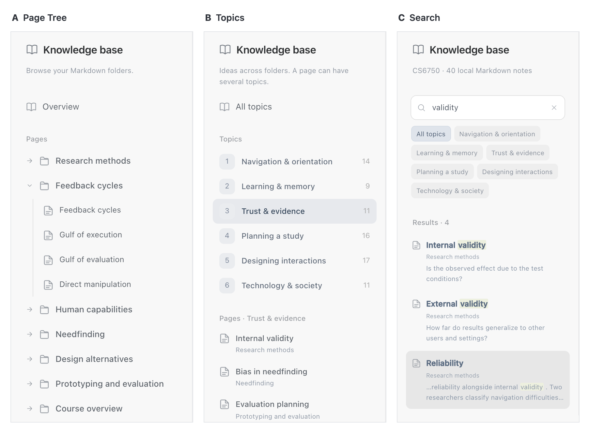

# Knowledge navigation prototype

CS6750 Individual Project research prototype. Application styling is based on a supplied Codex screenshot. Wiki navigation is a proposed design, not a released product feature. The knowledge base contains 40 original course-study resources in nine folders and six cross-cutting topics, with source notes, examples, and review questions. No course PDFs or lecture transcript passages are published.

## Views

- `index.html?mode=A`: page tree
- `index.html?mode=B`: cross-cutting topics and visit trail
- `index.html?mode=C`: ranked keyword search with excerpts, folder context, topic scope, and recent pages
- `index.html?mode=current`: reconstruction of the author-reported chat/file workflow
- `basic.html`: original low-fidelity wireframes

Add `&study=1` to hide the alternative-switching bar for a focused study link. The current-workflow view is a reconstruction, not a captured baseline. This static demo has no account connection, private-file access, analytics, or survey-response collection.

Serve these files with any static host; no installation or build step is required.

The current-workflow view follows the supplied screenshot: chat sessions grouped under a project, a center chat pane, and a separate Markdown file preview on the right. It has no Wiki entry, generated Related pages section, or added cross-page links. Notes are opened from file references in a session.

## Current navigation comparison

A browses the Markdown folder hierarchy. B groups pages into six cross-cutting topics; one page can belong to several topics, and each topic includes pages from multiple folders. For example, Internal validity appears under Trust & evidence and Planning a study while retaining its Research methods folder.

C searches across 40 course notes. The example query `validity` ranks matching titles first and displays each result's folder and a short excerpt. Rounded, clickable topic chips narrow the scope. The visible cloud uses the six cross-cutting topics. Search is local keyword matching.

- [Option A — Page tree](screenshots/option-a-cloud-v5.png)
- [Option B — Cross-cutting topics](screenshots/option-b-cloud-v5.png)
- [Option C — Contextual search](screenshots/option-c-cloud-v5.png)
- [A–B–C horizontal comparison](screenshots/navigation-options-abc-horizontal-v4.png)

Each actual UI capture is 278 CSS pixels wide at 2× scale, with matching top alignment and shared context rows. Equal-height frames accommodate clean row boundaries (A/B crops: 598 CSS px; C: 588 CSS px). Combined PNG: 1808 × 1328 pixels. The captures show Reliability opened after Internal validity. These are images of the research prototype.

Example views: `?mode=B&topic=Trust%20%26%20evidence` and `?mode=C&q=validity&page=validity`.
